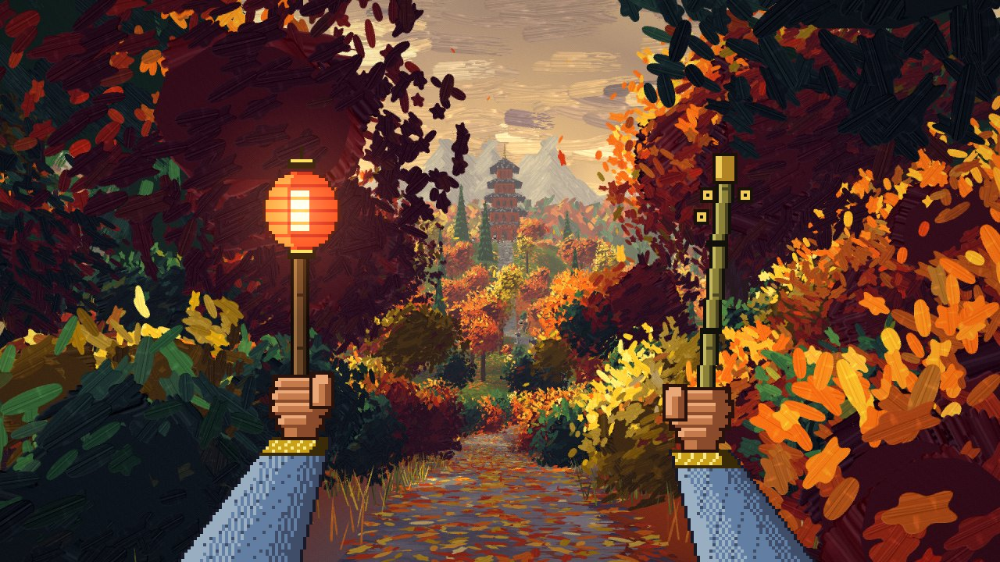
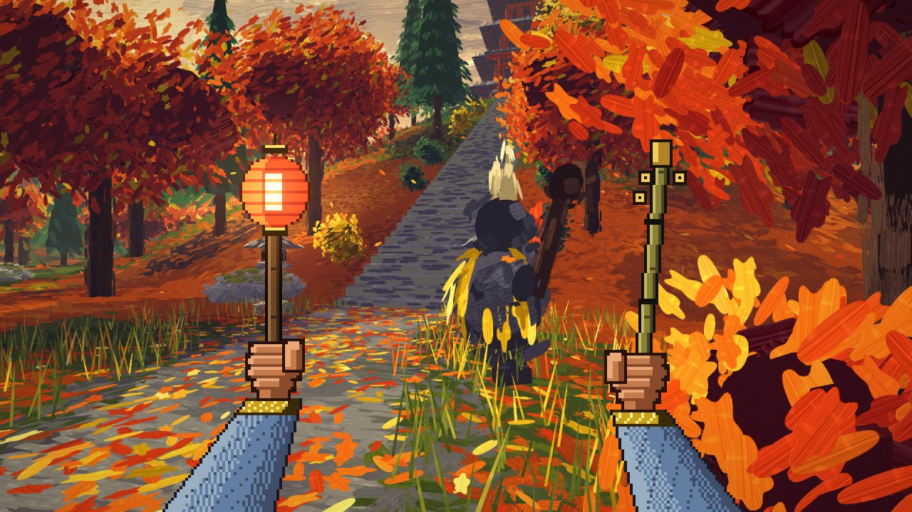
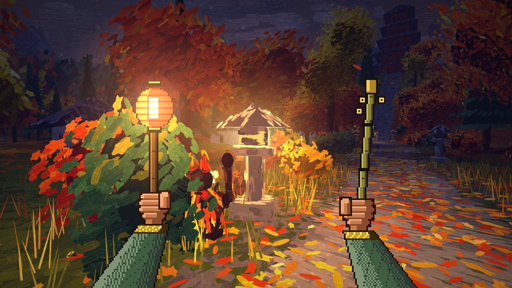
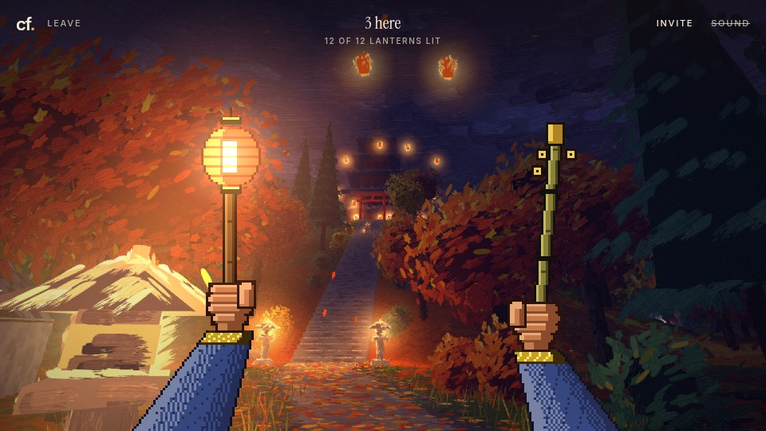
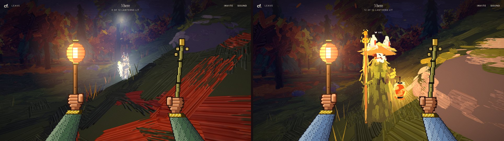
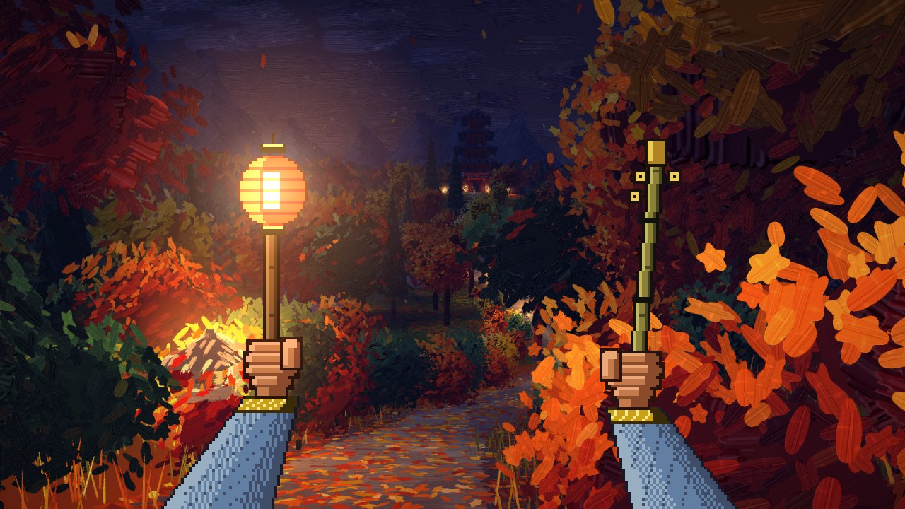
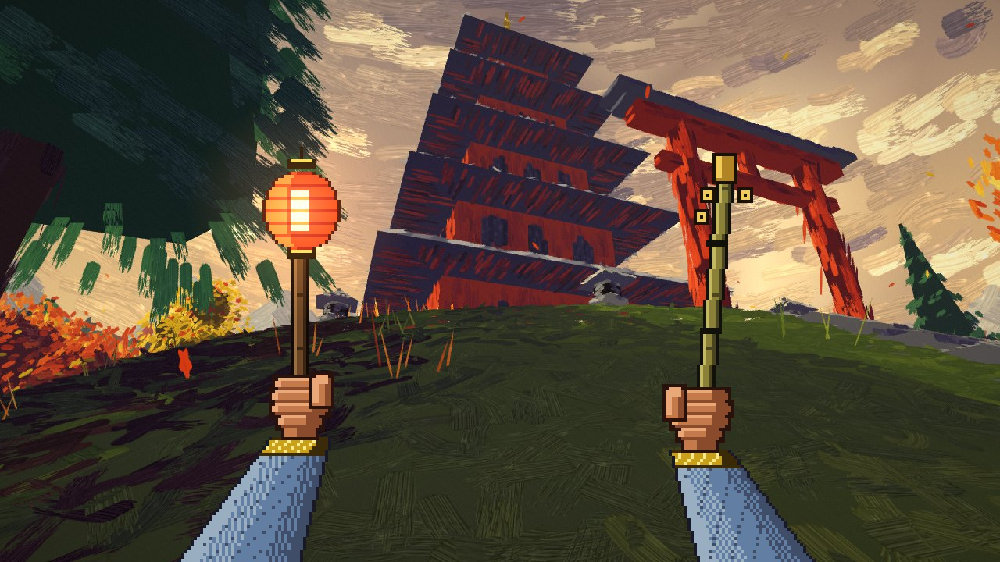

# Emberleaf

A small multiplayer walk for the browser. Up to twelve people come down out of a wood into
a painted autumn valley, light the stone lanterns on the way up to the shrine, and fight off
the imps that put them out. There are no accounts and nothing to install, and it plays on
phones and laptops.

**Play:** https://cashel.dev/emberleaf/



## How it plays

- You arrive in a sunken lane on a wooded ridge, with a paper lantern in one hand and a staff
  in the other. The lane runs down into the valley, and the shrine stands across it on its hill.
- Everyone else in the valley is there too, in a robe and a straw hat, with their name over them.
- **Imps** live along the path, and an **ogre** stands at the foot of the steps and another
  before the shrine. They see you from about 13 m, run at you and raise a club. Step back before
  it comes down, or swing your staff: it strikes everything in reach before you. An imp takes
  three blows, an ogre nine. Everyone in the valley sees and fights the same creatures.
- You have five hearts. They show while you are hurt and come back when no blow has landed for
  a while.
- **Struck down**, you lie where you fell. Anyone who rings their staff beside you lifts you,
  with three hearts. If nobody does within fourteen seconds, or you would rather not wait, you
  start again in the lane. With nobody else in the valley you start again after a moment.
- Twelve stone lanterns stand along the path, the steps and the shrine's terrace. Walk up to a
  dark one and light it. A lantern burns for four minutes, and everyone sees it.
- Nothing strikes anyone standing by a lit lantern. But **the imps put lanterns out.** One that
  sees nobody to go for creeps up on a lantern near its home, and one that sees you sheltering
  by a lantern comes for the flame. It chitters, jumps at the lantern for three seconds, and
  the lantern goes dark, unless someone strikes it first. A lantern lit in the last 25 seconds
  is too bright for them, and the first lantern in the lane is out of their reach.
- **When all twelve burn at once**, the shrine's bell rings for everyone, every creature leaves
  the valley until one goes out, and a paper lantern rises from each stone one and then a
  flight of them from the shrine. Everyone there has one of their own to let go. The start
  screen says how many times a valley has been lit like this.
- **A white fox** comes out at nightfall and sits somewhere away from the path, a different
  place each night, with a pale fire over it. It calls now and then. Whoever reaches it first
  wears its mask, which everyone can see, until the next nightfall. It is gone by dawn.
- Anywhere else, the same key rings your staff on the ground: a chime and a ring of light. It is
  the only way to talk.
- Day turns to night every seven minutes, by the server's clock, so everyone sees the same hour.
  Lanterns, yours and everyone's, light the paint around them.

| | Keyboard and mouse | Touch |
|---|---|---|
| Walk | WASD or arrow keys, Shift runs | Drag the left half; the stick stays where you first touch |
| Look | Click the valley, then move the mouse (Esc frees it) | Drag the right half |
| Swing the staff | Click, or F | Tap the right half |
| Light a lantern, lift someone, let a paper lantern go, or ring the staff | E or Space | The round button |
| Mute | M | The Sound button |

The start screen only asks for a name and a robe; what the one key would do is said at the
foot of the picture when there is something for it to do.









### Valleys

Everyone who presses **Walk in** lands in the same public valley. A valley holds twelve
people; when it is full a second public valley opens. **Private valley** creates one with
its own link, and anyone who opens the link joins it. A valley exists from the moment its
first visitor arrives until its last one leaves, and its lanterns go dark with it. Only the
count of how often it has been fully lit is kept.

Two monks, Ash and Wren, walk the path so that a lone visitor has company. They light a
lantern now and then, and leave as people arrive, so that there are always at least three
figures in a valley. The creatures leave the monks alone. A monk who rings its staff beside
someone struck down lifts them like anyone else, and the monks let a paper lantern go too.

Each visitor picks a robe colour on the start screen. No two people in a valley wear the
same one: if yours is taken, the server gives you the next spare.





## How it is built

```
index.html      the page: start screen and the few words on screen
style.css       all styling
game.js         the client: input, walking, sound, networking, the frame
paint.js        the painter: the brush, the dabs and their shader
world.js        the valley: its ground, and a painter for each kind of thing in it
figures.js      the other pilgrims, the creatures, the fox and the paper lanterns
hands.js        your own hands, as pixel sprites
shared.js       rules, the lie of the land, how the creatures behave and where the fox sits,
                used by both the client and the server
server/
  worker.js     the room server (Cloudflare Worker + Durable Object)
  wrangler.toml its configuration
```

### Client

The client is plain HTML, CSS and JavaScript modules with no build step.
[three.js](https://threejs.org) r160 is loaded from jsDelivr at a pinned version through
an import map. There are no image, model or audio files.

- **A picture in depth.** The walk is laid out so that it moves like a painting you walk
  into. It starts in a lane with leaves close on both sides, so the near paint sweeps past the
  eye in large strokes, while the pagoda across the valley, the hills and the sky hold still
  and everything between slides apart. The walk hardly moves the eye; its life is in the hands.
- **Paint.** The whole valley is made of dabs: single marks of a brush, pinned to points
  in the world, over coarse flat-coloured shapes so that nothing shows between them. About
  600,000 dabs are drawn as instanced cards (250,000 on a phone). A dab either turns to the
  eye and runs along a direction (leaves, boughs, grass, cloud) or lies on its surface and
  runs along its grain (ground, steps, walls, roofs, bark). A lying dab seen edge on, where
  it would thin to a sliver, is stood up to face the eye, so far ground is still brushwork
  on the picture. Nothing is a filter over the screen: as you walk, near strokes slide past
  far ones.
- **The brush** is a sheet of eight marks drawn in code when the page loads.
- **Colours are mixed once**, when the valley is built: a tone from a six-step ramp, picked
  by light and chance. There are no lights. A dab takes sun or shade whole, so the edge of a
  tree's shadow is a ragged line of whole dabs.
- **Every stroke is sized against the picture.** Each kind of dab has a least and a most size
  on screen. Too far to be seen at its least size, only the low-ranked dabs of a thing stay,
  grown to cover the rest; too near, a dab stops growing. Strokes are finest along the path
  and in the trees beside it, and coarse where nobody comes near.
- **Night and lamplight** are added in the shader: the paint is darkened toward blue, and
  each burning lantern warms the paint near it.
- **The valley is built from fixed seeds**, so every player sees the same trees and stones
  without the server sending any of it.
- **Your hands** and your hearts are pixel sprites drawn over the picture. The sleeves take
  your robe colour.
- **Figures.** Each part of a pilgrim or a creature is painted once and moves as a whole, so
  the strokes stay on it as it walks.
- **Sound** is synthesised with the Web Audio API.
- **Frame rate.** The game watches its own frame rate and draws fewer pixels when it cannot
  keep up. `?paint=0.5` (0.2 to 1.5) builds the valley with less or more paint.

The look follows the same idea as [castle-valley](https://github.com/remorses/castle-valley)
(a painted world under pixel hands), which is what prompted this. None of its code or art is used.

### Server

Each valley is one [Durable Object](https://developers.cloudflare.com/durable-objects/)
on Cloudflare Workers, in the same way as [Starfall](https://github.com/CashelF/starfall).

Each browser reports its own position, which keeps walking instant for the player; the
server limits how far a position may move between reports and keeps everyone inside the
valley. It moves the creatures and decides whose blow landed, who is hurt, who is lifted,
which lanterns burn, when the bell rings and who found the fox, and ticks ten times a second.
Those rules live in [shared.js](shared.js), so a valley with no server (`?solo`) runs the
same ones in the page.

`GET /r/<valley>/stats` answers the start screen with how many times every lantern has burned
at once in that valley, and how many people are in it now.

Players talk to the room over a WebSocket, in JSON:

| Direction | Message | Meaning |
|---|---|---|
| client → server | `hi {name, c}` | join with a name and a robe colour |
| | `p {x, z, a}` | where I stand and which way I face, about twelve times a second while moving |
| | `l {i}` | I am lighting lantern `i` |
| | `w {a}` | I am swinging my staff, facing `a` |
| | `e` | I am ringing my staff, which lifts anyone struck down beside me |
| | `up` | I am struck down and would rather start again than wait |
| | `k` | I am letting my paper lantern go |
| | `ping {c, here}` | clock sync, and whether I am still at the controls |
| server → client | `welcome {...}` | your id, everyone in the valley, when each lantern burns out, the fox, and the count of bells |
| | `join {p}`, `leave {id}` | someone arrived or left |
| | `s {ps, ms}` | positions of the people and the creatures that moved, and what each creature is doing |
| | `w {id}`, `hit {id, by, dead}` | someone swung; a creature was struck, or felled |
| | `cry {id}` | a creature has seen someone |
| | `hurt {id, hearts, by}`, `hearts {id, hearts}` | a blow landed on someone; a heart came back |
| | `down {id, wait}` | someone was struck down, and how long they have to be lifted |
| | `rise {id, x, z, hearts, by}` | they are up: lifted by `by` where they fell, or starting again |
| | `l {i, until, by}`, `out {i, by}` | a lantern was lit; an imp put one out |
| | `bell {by, n}` | the last dark lantern was lit, for the `n`th time in this valley |
| | `sky {id, x, z}` | someone let a paper lantern go |
| | `fox {night, gone}`, `found {id, night}` | the fox came out, or left at dawn; someone reached it |
| | `e {id}`, `pong {c, now}` | someone rang their staff; clock sync |

Guards against misuse: connections are only accepted from the game's own site, each socket
may send 60 messages a second of at most 300 characters, names are reduced to 12 letters,
digits and a few punctuation marks, a lantern can only be lit by someone standing near it,
a staff can be swung about twice a second and only strikes what the server sees in its reach,
and a player who has not touched the controls for a few minutes is let go. The server
stores one number for each valley, the count of times it has been fully lit; everything else
exists only in memory while someone is in it.

## Running it yourself

You need Node.js for the server and any static file server for the client.

```bash
# the room server, on port 8793
cd server
npx wrangler dev --port 8793

# the client, in another terminal, from the repository root
python3 -m http.server 8010
```

Open http://localhost:8010. On any host other than the published site, the client looks
for the room server on port 8793 of whichever machine served the page.

http://localhost:8010/?solo walks the valley with no server at all: the creatures are there,
and two monks, but nobody else.

To play from a phone on the same network, serve both on an address the phone can reach,
and tell the local server to accept any origin:

```bash
npx wrangler dev --port 8793 --ip 0.0.0.0 --var DEV_ANY_ORIGIN:1
python3 -m http.server 8010 --bind 0.0.0.0
```

`DEV_ANY_ORIGIN` only exists in that local command; the deployed server never sets it.

### How this copy is published

- **The page** is this repository's root, served as it is by GitHub Pages from the `main`
  branch at https://cashel.dev/emberleaf/. There is no build step, and `.nojekyll` tells
  Pages not to run one. A push to `main` is a release.
- **The room server** is the Worker `emberleaf`, deployed from `server/` with
  `npx wrangler deploy`. It only needs deploying again when [server/worker.js](server/worker.js)
  or [shared.js](shared.js) changes. A deploy ends every valley that is open; players are
  reconnected to a fresh one.
- The card for the game on https://cashel.dev lives in that site's own repository.

### Hosting your own copy

1. In `server/`, run `npx wrangler deploy`. It prints the Worker's address.
2. In [game.js](game.js), point `SERVER` at that address and change the hostname test above
   it to your site.
3. In [server/worker.js](server/worker.js), change `ORIGIN` to your site, then deploy again.
4. Put the files in the repository root on any static host.

### What the free plan allows

At the time of writing, Cloudflare's free plan allows 100,000 Durable Object requests a day,
with 20 WebSocket messages counted as one request, and 13,000 GB-seconds of running time. A
walking player sends about twelve messages a second, so that is roughly 45 hours of walking a
day added up across all players, or about 28 hours of valleys being open. The allowance is for
the whole Cloudflare account, so it is shared with anything else the account runs. When it
runs out the game cannot be joined until it resets at midnight UTC; nothing is charged.

## Credits

Made by [Cashel Fitzgerald](https://cashel.dev). Rendering by
[three.js](https://threejs.org); type is Instrument Serif and Inter.
